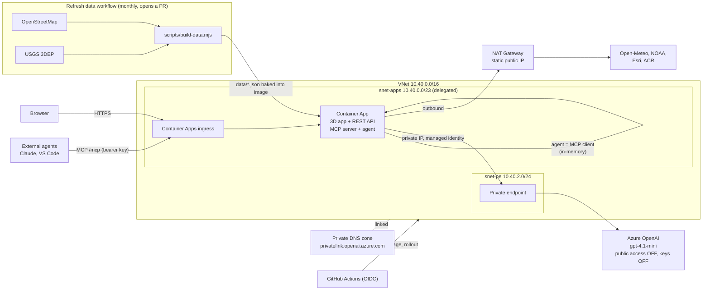

# Hampton Roads Flood What-If

A 3D flood what-if dashboard for **Norfolk, Virginia Beach and Williamsburg**, an **MCP server** that gives AI agents the same answers the map shows, and an **Azure OpenAI agent** ("Ask the map") that answers plain-English questions by calling those MCP tools and then drives the map. Raise the water level and see which critical facilities (power, water and wastewater, hospitals, fire/EMS, police, schools, telecom) end up at or below it, how deep, and how much of the land is affected.

Built with the ArcGIS Maps SDK for JavaScript (SceneView), Angular, Node/Express, the MCP TypeScript SDK and Azure OpenAI. Deployed to Azure Container Apps inside a VNet with a NAT Gateway, with Azure OpenAI reachable only through a private endpoint, using Terraform and GitHub Actions (OIDC, no stored Azure credentials).

> **What-if, not a forecast.** This is a screening ("bathtub") model. See [Method and limits](#method-and-limits).



## What's in the app

- **3D scene**: satellite imagery on World Elevation terrain, optional 3D buildings, and an animated water surface that rises to the selected level.
- **Facility pins**: every critical facility in the area, coloured dry / under 1.5 m / 1.5 m or more. Click one for its ground elevation, the level at which it first gets wet, and depth at +1/+2/+3 m.
- **Exposure panel**: facilities exposed at the current level by category, the deepest ones (click to fly there), a +1/+2/+3 m comparison with category-stacked bars, and the share of sampled land at or below each level.
- **Water level dock**: presets 0 / +1 / +2 / +3 m, a 0–5 m slider, and a "use live tide" shortcut when the nearest NOAA gauge reports in NAVD88.
- **Live context**: current weather and 5-day forecast (Open-Meteo) and the latest tide-gauge reading (Sewells Point, CBBT, Yorktown). Context only; not linked to the scenario.

## Ask the map (Azure OpenAI + MCP)

Type a question such as *"Which hospitals and substations in Norfolk are under water at +2 m?"* in the left panel. The server-side agent (`api/src/agent.js`):

1. Connects to this app's own MCP server as a **real MCP client** (in-memory transport: the same tools and code path external agents use at `/mcp`).
2. Lists the MCP tools and offers them to Azure OpenAI as function-calling tools.
3. Runs a short tool-calling loop (at most 5 steps): the model chooses tools and arguments, the MCP server executes them against the exposure engine, and the results go back to the model.
4. Returns the answer, the list of tools it called (shown in the UI), and a **map action**: the dashboard switches to the area and water level the agent looked up, or flies to the facility it examined.

The model writes the prose; every number comes from a tool call. The system prompt forbids invented figures, requires the what-if caveat, treats tool output as data rather than instructions, and sends forecast, evacuation and safety questions to official sources. `/api/ask` has its own rate limit (10 per minute per client), and the model deployment's tokens-per-minute quota caps total spend.

Auth is keyless: the Container App's managed identity has **Cognitive Services OpenAI User** on the account, and the account has key auth and public network access disabled.

## MCP server

The engine behind the map is also an MCP server at `/mcp` (Streamable HTTP, stateless), so an agent can answer questions like *"Which hospitals and substations in Norfolk are under water at +2 m, and how deep?"* with the same numbers the dashboard shows.

| Tool | What it returns |
|---|---|
| `list_areas` | Areas, facility categories, facility counts, data date |
| `flood_exposure` | Exposed facilities at a water level (deepest first), counts by category, % of land flooded |
| `compare_scenarios` | Exposure and land flooded across several levels |
| `find_facilities` | Facilities by category and/or maximum ground elevation, lowest first |
| `facility_details` | Ground elevation, flood-onset level, depth at +1/+2/+3 m |
| `current_conditions` | Live weather and latest tide reading |

All tools are read-only, return structured content, and report bad input (unknown area, level out of range) as tool errors the agent can recover from.

**Connect** (after a deploy, get the values with `terraform output -raw mcp_url` and `terraform output -raw mcp_api_key` in `infra/app`):

```bash
# Claude Code
claude mcp add --transport http hampton-roads-flood "$MCP_URL" --header "Authorization: Bearer $MCP_API_KEY"
```

```jsonc
// VS Code: .vscode/mcp.json (prompts for the key; nothing stored)
{
  "inputs": [{ "id": "flood-key", "type": "promptString", "description": "MCP API key", "password": true }],
  "servers": {
    "hampton-roads-flood": {
      "type": "http",
      "url": "https://<your-app>.azurecontainerapps.io/mcp",
      "headers": { "Authorization": "Bearer ${input:flood-key}" }
    }
  }
}
```

Locally, `npm run dev` in `api/` opens `/mcp` without a key so you can use the MCP Inspector (`npx @modelcontextprotocol/inspector`, Streamable HTTP, `http://localhost:8080/mcp`). Deployed, the endpoint requires the bearer key and is rate limited; the deploy smoke test fails if it answers without one. For multi-user use, replace the key with Entra ID OAuth per the MCP authorization spec.

## Network

| AWS concept | Here |
|---|---|
| VPC | VNet `10.40.0.0/16` |
| Private app subnet | `snet-apps` `/23`, delegated to Container Apps (workload-profiles environment) |
| NAT gateway in a public subnet | NAT Gateway + static public IP attached to `snet-apps`: all outbound traffic leaves from one address (`terraform output nat_egress_ip`) |
| Interface VPC endpoint + private hosted zone | Private endpoint in `snet-pe` + private DNS zone `privatelink.openai.azure.com` linked to the VNet |
| ALB | Container Apps' built-in ingress (public, HTTPS) |

The app is public on purpose (it's a demo site), but Azure OpenAI is not reachable from the internet at all: only from inside the VNet. To make the app itself private too, set `internal_load_balancer_enabled = true` on the environment and front it with Application Gateway or Front Door.

Toggles in `infra/app/variables.tf`: `enable_nat_gateway`, `enable_ai`, `openai_private_endpoint`. Turning off the NAT Gateway cuts most of the fixed cost; Container Apps then uses default outbound.

## Data

`scripts/build-data.mjs` writes three files into `data/`, which are baked into the container image:

| File | Contents |
|---|---|
| `assets.geojson` | Critical facilities from OpenStreetMap (nodes, and centre points of ways/relations) within each area's box, each with ground elevation |
| `land-samples.json` | A 30×30 grid of ground elevations per area, for the "% of land" figure |
| `manifest.json` | Generation time, counts per area, elevation source counts |

Elevation comes from the USGS 3DEP Elevation Point Query Service (meters, NAVD88). If a USGS request fails after retries, that point falls back to Open-Meteo's Copernicus 90 m DEM and is labelled as such in the data. Areas are defined in `data/areas.json` as bounding boxes, not city limits, each with a starting camera; edit that file to add or reshape an area or adjust the view.

Run it with the **Refresh data** workflow (monthly, or on demand; it opens a PR) or locally with Node 22+: `node scripts/build-data.mjs`. It makes a few thousand public API requests and takes several minutes.

## Run locally

```bash
node scripts/build-data.mjs                 # once, needs internet
cd api && npm ci && npm run dev             # http://localhost:8080 (API + MCP)
cd web && npm ci && npx ng serve            # http://localhost:4200 (proxies /api and /mcp)
```

To try "Ask the map" locally, point `AZURE_OPENAI_ENDPOINT` (and `AZURE_OPENAI_DEPLOYMENT`) at an Azure OpenAI deployment your `az login` account can reach with the *Cognitive Services OpenAI User* role. The deployed account is private-endpoint only, so it can't be reached from a laptop; use a separate dev deployment. Without an endpoint the panel shows that the assistant is off and everything else works.

Optional: `export ARCGIS_API_KEY=...` before starting the API. The app uses Esri's World Imagery basemap and World Elevation terrain; the 3D buildings service may require a key, and if it can't load, the buildings toggle disables itself instead of breaking the scene.

Tests: `cd api && npm test` covers the exposure maths, the data builder (with mocked OSM/USGS/Open-Meteo responses, including the fallback), the REST API, and every MCP tool through the official MCP client.

## Deploy to Azure

Same pattern as the companion `azure-openai-sentiment-demo` repo.

Prerequisites: quota for `gpt-4.1-mini` (GlobalStandard) in your region (or set `openai_location`), and these resource providers registered: `Microsoft.App`, `Microsoft.ContainerService`, `Microsoft.ContainerRegistry`, `Microsoft.OperationalInsights`, `Microsoft.ManagedIdentity`, `Microsoft.Network`, `Microsoft.CognitiveServices` (the bootstrap does this).

1. **Bootstrap once** (as subscription Owner): `cd infra/bootstrap && terraform init && terraform apply`, then `terraform output -raw github_setup_commands | bash` to set the repo's Actions variables and the `production` environment.
2. **Optional**: add an `ARCGIS_API_KEY` repository secret (an ArcGIS Location Platform key with basemap access, restricted to your app's URL) to enable 3D buildings.
3. **Generate data**: run *Refresh data* and merge its PR.
4. Merging to `main` runs *Deploy*: Terraform apply, image build and push to ACR, new Container Apps revision, then a smoke test of the API, MCP tools, and MCP auth.

## Method and limits

A facility is **exposed** when the scenario water level, in meters above NAVD88 (roughly mean sea level), is at or above its ground elevation. Depth is the difference. The land figure is the share of grid samples with ground above 0 m that sit at or below the level.

This deliberately simple model ignores:
- whether water can actually reach a low spot (hydraulic connectivity), levees, floodwalls and pump stations;
- rainfall, drainage capacity, waves, wind setup, and duration;
- building floor heights and critical equipment elevations (a facility's ground elevation is not its first-floor height);
- vertical datum differences between NAVD88 and the terrain used for the 3D water surface (well under a meter here), so the rendered water is a visual guide and the numbers come from the USGS elevations.

OpenStreetMap coverage of facilities is good but not complete, and some facilities are mapped as large areas represented here by a single centre point.

For planning-grade analysis, use NOAA's Sea Level Rise Viewer and storm-surge (SLOSH/MOM) products and local floodplain studies. This project is for exploration and demonstration, not for planning or emergency decisions.

## Cost

Approximate list prices (check the Azure pricing calculator for your region):

| Item | Approx. per month |
|---|---|
| NAT Gateway + static public IP | ~$36 plus data processed |
| Private endpoint | ~$7 |
| Container Registry (Basic) | ~$5 |
| Private DNS zone, Log Analytics | ~$1–3 |
| Container Apps (scales to zero) | ~$0 idle |
| Azure OpenAI gpt-4.1-mini | pay per token: a question with tool calls is a few thousand tokens, well under a cent |

So roughly **$50/month** with the full private-network setup, or about **$5–10/month** with `enable_nat_gateway = false`. Destroy the stack when you aren't demoing to stop the fixed costs. Open-Meteo, NOAA, USGS and Overpass are free public APIs (used within their fair-use limits: cached, rate limited, and monthly for data builds). A demo's ArcGIS basemap traffic should stay within the Location Platform free tier; check Esri's current limits.

## Attribution

Facilities © [OpenStreetMap](https://www.openstreetmap.org/copyright) contributors (ODbL). Elevation: USGS 3D Elevation Program. Weather: [Open-Meteo](https://open-meteo.com/) (CC BY 4.0). Tides: NOAA CO-OPS. Basemaps, terrain and buildings: Esri and its data providers, used under the [ArcGIS terms](https://www.esri.com/en-us/legal/terms/full-master-agreement).
